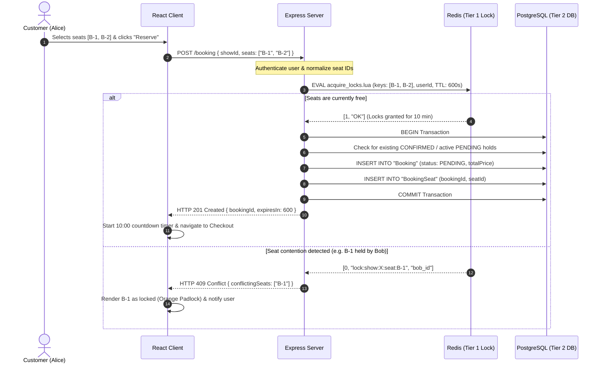
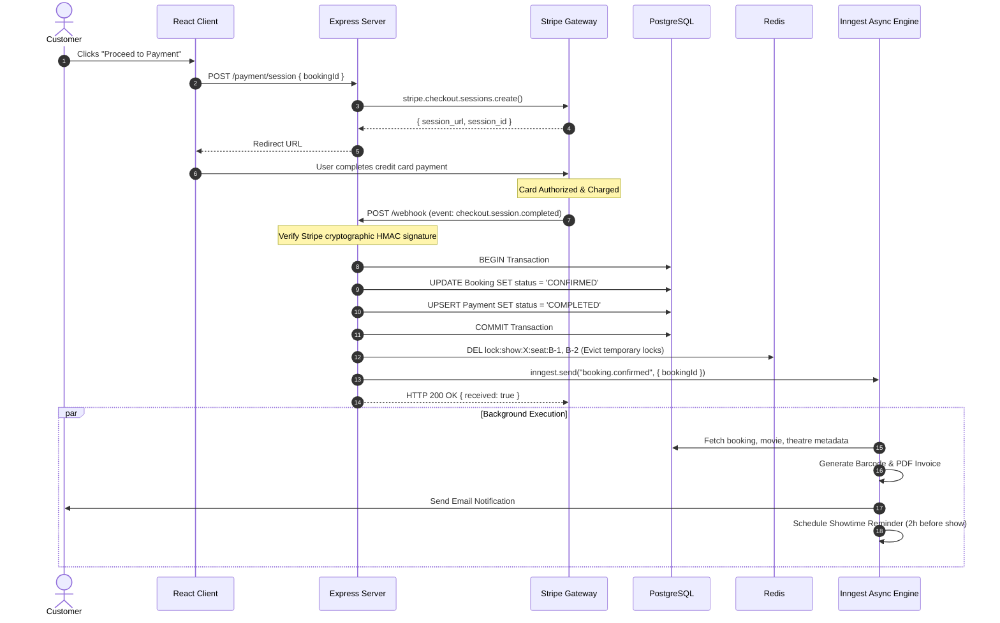
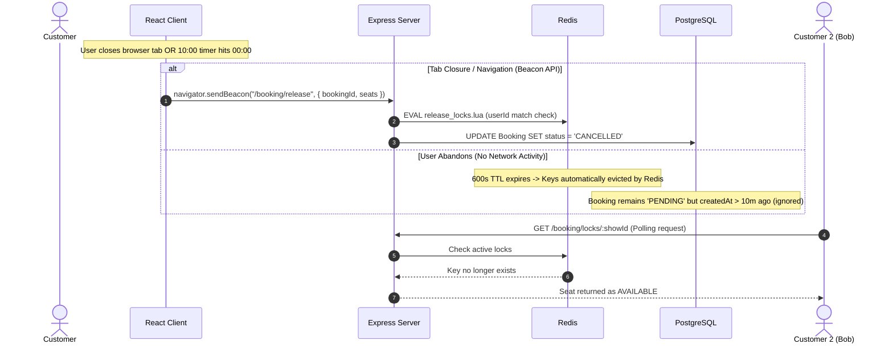

# 🏛️ ShowCity — High-Level Design (HLD) Document

> **System**: ShowCity High-Concurrency Movie Ticket Reservation Platform  
> **Repository**: [github.com/mishraa-G/show_city](https://github.com/mishraa-G/show_city)  
> **Status**: Production-Ready Architecture  
> **Document Version**: 1.0.0  

---

## 📋 Table of Contents
1. [Executive Summary & Problem Statement](#1-executive-summary--problem-statement)
2. [System Requirements](#2-system-requirements)
   - [Functional Requirements (FR)](#functional-requirements-fr)
   - [Non-Functional Requirements (NFR)](#non-functional-requirements-nfr)
3. [Capacity Estimation & Scale](#3-capacity-estimation--scale)
4. [System Architecture Diagram](#4-system-architecture-diagram)
5. [Core Components & Responsibilities](#5-core-components--responsibilities)
6. [Data Flow & Request Lifecycles](#6-data-flow--request-lifecycles)
   - [Flow 1: Atomic Seat Hold Acquisition](#flow-1-atomic-seat-hold-acquisition)
   - [Flow 2: Payment & Asynchronous Ticket Issuance](#flow-2-payment--asynchronous-ticket-issuance)
   - [Flow 3: Session Expiration & Abandoned Cart Recovery](#flow-3-session-expiration--abandoned-cart-recovery)
7. [Architectural Decisions & Trade-Offs](#7-architectural-decisions--trade-offs)
   - [CAP Theorem Positioning](#cap-theorem-positioning)
   - [Two-Tier Locking Strategy](#two-tier-locking-strategy)
   - [Polling vs. WebSockets / SSE](#polling-vs-websockets--sse)
   - [Database Choice & Sharding Strategy](#database-choice--sharding-strategy)
8. [High Availability & Fault Tolerance](#8-high-availability--fault-tolerance)
9. [Security & Idempotency Architecture](#9-security--idempotency-architecture)
10. [Observability & Disaster Recovery](#10-observability--disaster-recovery)

---

## 1. Executive Summary & Problem Statement

### The Problem Domain
High-demand ticketing platforms (such as Ticketmaster, BookMyShow, and Fandango) experience extreme traffic spikes during blockbuster movie releases or concert drops. When thousands of concurrent users attempt to reserve the same finite inventory (seats) simultaneously:
- Standard relational databases suffer from **Time-Of-Check to Time-Of-Use (TOCTOU)** race conditions if using naive `SELECT` followed by `UPDATE/INSERT`.
- Database lock contention causes connection pool exhaustion, elevated latency, and transaction rollbacks.
- **Double-booking** leads to duplicate card authorizations, customer dissatisfaction, and manual refund overhead.

### The Solution: ShowCity
ShowCity implements a distributed **Two-Tier Reservation Engine**:
- **Tier 1 (Sub-millisecond In-Memory Distributed Lock)**: Atomic Redis Lua scripts enforce a 10-minute hold window before any heavy database operation occurs.
- **Tier 2 (PostgreSQL ACID Transactions)**: Guarantees strict transactional persistence for confirmed reservations with composite constraints.
- **Resilient Fallback**: In the event of cloud network partitions or Redis disconnections, an internal Node.js in-memory mutex engine guarantees zero system downtime.

---

## 2. System Requirements

### Functional Requirements (FR)
1. **Catalog Browsing**: Users can browse active movies, filter by date, location, and theatre, and inspect show details.
2. **Interactive Seat Layout**: Users can view real-time seat availability across 3 states: `AVAILABLE`, `HELD` (Locked for 10 min), and `BOOKED` (Permanent).
3. **Atomic Multi-Seat Hold**: Users can select up to $N$ seats and atomically hold them for 10 minutes. If even one seat is contested, the batch fails cleanly without partial holds.
4. **Hold Countdown & Auto-Release**: A synchronized 10-minute countdown displays to the holding user. If payment is not completed within 10 minutes or the user navigates away, seats are immediately released back to the inventory pool.
5. **Secure Payment Processing**: Integrated checkout powered by Stripe.
6. **Ticket Confirmation & Notifications**: Dispatches confirmation emails and calendar reminders asynchronously upon verified payment completion.
7. **Interview Simulation Mode**: Allows concurrent user testing using dual identities across distinct browser sessions.

### Non-Functional Requirements (NFR)
1. **Zero Double-Bookings (Strict Consistency - CP)**: Under no circumstances should two users be permitted to hold or book the same seat for the same show.
2. **Sub-Millisecond Lock Latency**: Lock acquisition and verification must complete in $< 10\text{ ms}$ at the cache tier to handle traffic bursts.
3. **High Availability**: $99.95\%$ uptime for catalog browsing, seat inspection, and reservation creation.
4. **Idempotent Webhooks**: All payment webhooks must be safely replayable without generating duplicate tickets or double billing.
5. **Graceful Degradation**: In the event of Redis outage, the platform seamlessly fails over to an in-memory lock engine.

---

## 3. Capacity Estimation & Scale

### Traffic Assumptions (Blockbuster Opening Day)
- **Daily Active Users (DAU)**: 1,000,000 users.
- **Peak Flash-Sale Window**: Top 15 minutes of ticket launch for high-demand screenings.
- **Concurrent Users**: 50,000 concurrent users contending for seats.
- **Show Inventory**: 100 theatres $\times$ 5 screens $\times$ 200 seats = 100,000 total seats available across multiple time slots.

### QPS (Queries Per Second) Estimation
- **Read QPS (Catalog & Seat Polling)**:
  - 50,000 active users polling seat layouts every 3 seconds:
    $$\text{Seat Poll QPS} = \frac{50,000}{3} \approx 16,666\text{ req/s}$$
  - Handled via Edge CDN and Redis read-replicas.
- **Write QPS (Lock Acquisitions & Bookings)**:
  - Estimated 2,000 seat hold attempts per second during initial drop:
    $$\text{Write QPS} \approx 2,000\text{ req/s}$$
  - Handled atomically via single-threaded Redis Lua scripts.

### Storage & Memory Estimation
- **Redis Lock Footprint**:
  - Key format: `lock:show:{showId}:seat:{seatId}` ($\approx 45\text{ bytes}$)
  - Value: `userId` UUID ($\approx 36\text{ bytes}$)
  - Total per lock: $\approx 100\text{ bytes}$ (including Redis metadata).
  - 100,000 concurrent holds:
    $$100,000 \times 100\text{ B} = 10\text{ MB}$$
  - Even with 1 million concurrent holds, Redis memory requirement is $< 100\text{ MB}$.
- **PostgreSQL Database Storage**:
  - `Booking` record: $\approx 250\text{ bytes}$
  - `BookingSeat` link: $\approx 80\text{ bytes}$
  - 1,000,000 tickets/month $\approx 350\text{ MB/month}$ ($\approx 4.2\text{ GB/year}$).

---

## 4. System Architecture Diagram

```
                                  ┌─────────────────────────────────┐
                                  │      Client Applications        │
                                  │  (React 19, TypeScript, Vite)   │
                                  └───────────────┬─────────────────┘
                                                  │ HTTPS / JSON
                                                  ▼
                                  ┌─────────────────────────────────┐
                                  │        Edge CDN & DNS           │
                                  │   (Vercel Edge / Cloudflare)    │
                                  └───────────────┬─────────────────┘
                                                  │
                                                  ▼
               ┌─────────────────────────────────────────────────────────────────────┐
               │                        Application Tier                             │
               │               Express 5 REST API Cluster (Node.js)                  │
               │                                                                     │
               │  ┌─────────────────┐  ┌──────────────────┐  ┌────────────────────┐  │
               │  │ Auth Middleware │  │ Lock Controller  │  │ Payment Controller │  │
               │  │  (Clerk / JWT)  │  │  & Normalizer    │  │  (Stripe Webhook)  │  │
               │  └─────────────────┘  └──────────────────┘  └────────────────────┘  │
               └───────────┬──────────────────────┬──────────────────────┬───────────┘
                           │                      │                      │
       Atomic Lock Acquire │                      │ Query / Settle       │ Dispatch
       & TTL Check (10m)   │                      │ ACID Transactions    │ Event
                           ▼                      ▼                      ▼
        ┌────────────────────────────┐ ┌────────────────────┐ ┌──────────────────────┐
        │       Distributed          │ │    Relational      │ │  Serverless Async    │
        │       Cache & Lock         │ │    Database        │ │  Background Worker   │
        │   Redis (Upstash / Memory) │ │   PostgreSQL       │ │      (Inngest)       │
        │   - Lua atomic script      │ │     (Neon)         │ │  - Ticket Email      │
        │   - Key: lock:show:X:seat:Y│ │  - ACID Isolation  │ │  - Show Reminders    │
        │   - 10-minute Auto-TTL     │ │  - PgBouncer Pool  │ │  - Retry Pipelines   │
        └────────────────────────────┘ └────────────────────┘ └──────────────────────┘
                           ▲                                             │
                           │ Fallback Engine                             ▼
                 ┌───────────────────┐                        ┌──────────────────────┐
                 │ Node.js In-Memory │                        │ Third-Party Services │
                 │ Mutex Engine      │                        │ - Stripe API         │
                 │ (Map + Sweep)     │                        │ - Clerk Auth         │
                 └───────────────────┘                        └──────────────────────┘
```

---

## 5. Core Components & Responsibilities

| Component | Technology | Primary Responsibility |
|---|---|---|
| **Client UI** | React 19, Vite, Tailwind CSS | Dynamic seat map grid, 10-minute countdown ticker, optimistic state updates, background polling, beacon cancellation. |
| **Authentication Service** | Clerk Backend / Frontend SDK | Manages session tokens, OAuth providers, and user identification headers (`x-demo-user` in demo mode). |
| **API Server** | Node.js, Express 5 | Validates requests, coordinates distributed locks, handles transactional DB operations, and hosts webhook listeners. |
| **Distributed Lock Engine** | Redis (Upstash) + Lua Scripting | Sub-millisecond atomic multi-key acquisition, TTL eviction, and safe lock release. |
| **Fallback Mutex Engine** | Node.js In-Memory `Map` | Guarantees local thread-safe lock management when Redis is temporarily unreachable. |
| **Primary Database** | PostgreSQL (Neon Serverless) | Relational source of truth for movies, screens, physical seats, confirmed bookings, and payment audit records. |
| **Background Job Engine** | Inngest Serverless Workflow | Durable execution of asynchronous side-effects: barcode generation, ticket email dispatch, and showtime reminders. |
| **Payment Gateway** | Stripe (Payment Intents / Sessions) | Secure PCI-compliant credit card processing with cryptographic webhook verification. |

---

## 6. Data Flow & Request Lifecycles

### Flow 1: Atomic Seat Hold Acquisition



---

### Flow 2: Payment & Asynchronous Ticket Issuance



---

### Flow 3: Session Expiration & Abandoned Cart Recovery



---

## 7. Architectural Decisions & Trade-Offs

### CAP Theorem Positioning
ShowCity adopts a **hybrid CP / AP approach**:
- **Seat Booking & Holding (CP - Consistency & Partition Tolerance)**: Under high contention, consistency is strictly prioritized over write availability. If there is doubt about whether a seat is free, the system rejects the booking with HTTP 409 Conflict rather than risk a double-booking.
- **Movie Catalog & Showtime Discovery (AP - Availability & Partition Tolerance)**: Movie metadata and schedules are cached aggressively at the edge and tolerate eventual consistency.

### Two-Tier Locking Strategy
```
+-------------------------------------------------------------------------------+
| Approach               | Pros                     | Cons                      |
+-------------------------------------------------------------------------------+
| 1. Pure Database Locks | Simple; native ACID      | Heavy DB connection lock  |
|    (SELECT FOR UPDATE) | transactions             | contention; fails at scale|
+-------------------------------------------------------------------------------+
| 2. Pure Redis Locks    | Extremely fast (<2ms);   | Risk of state drift if DB |
|                        | simple key expiry        | transaction fails         |
+-------------------------------------------------------------------------------+
| 3. Two-Tier Engine     | Sub-millisecond locks;   | Requires careful lock     |
|    (ShowCity Approach) | zero DB connection waste;| release coordination on   |
|                        | strict ACID persistence  | rollback                  |
+-------------------------------------------------------------------------------+
```

### Polling vs. WebSockets / SSE
- **Selected Approach: Short Polling (3-second cadence with backoff)**:
  - **Rationale**: Cinema seating maps have bursty demand (during seat selection) but zero traffic after checkout. Maintaining 50,000 persistent WebSocket or SSE connections places unnecessary memory and file-descriptor pressure on API gateways.
  - HTTP polling responses are lightweight JSON payloads containing only delta locks, allowing CDN edge caching with `stale-while-revalidate`.

### Database Choice & Sharding Strategy
- **PostgreSQL**: Chosen for ACID compliance, foreign key cascade constraints, and row-level locking capabilities.
- **Horizontal Sharding Key**: Shows and bookings partition naturally on `showId`. All reservation checks for a specific screening hit the same partition, minimizing cross-shard transactions.

---

## 8. High Availability & Fault Tolerance

```
                           ┌───────────────────────────┐
                           │   Incoming Hold Request   │
                           └─────────────┬─────────────┘
                                         │
                                         ▼
                           ┌───────────────────────────┐
                           │  Is Remote Redis Online?  │
                           └─────────────┬─────────────┘
                                         │
                        YES ┌────────────┴────────────┐ NO / TIMEOUT
                            ▼                         ▼
            ┌───────────────────────────┐ ┌───────────────────────────┐
            │  Tier 1: Redis Lua Script │ │ Tier 1 Fallback: Internal │
            │  (Atomic Cluster Exec)    │ │ In-Memory Mutex Engine    │
            └─────────────┬─────────────┘ └───────────┬───────────────┘
                          │                           │
                          └─────────────┬─────────────┘
                                        │
                                        ▼
                          ┌───────────────────────────┐
                          │ Tier 2: PostgreSQL ACID   │
                          │   Transaction with Hold   │
                          │   Cutoff Verification     │
                          └───────────────────────────┘
```

1. **Redis Circuit Breaker**: If Redis round-trip latency exceeds $500\text{ ms}$ or fails, the application switches to the internal in-memory mutex map without dropping requests.
2. **PostgreSQL Connection Pooling**: Managed via Neon's connection pooler (PgBouncer) to prevent connection exhaustion during flash crowds.
3. **Graceful Cancellation**: Any failure in the database layer immediately triggers a compensation script that deletes the Redis lock, preventing orphaned deadlocks.

---

## 9. Security & Idempotency Architecture

1. **Cryptographic Webhook Verification**:
   - Every incoming Stripe webhook is validated using `stripe.webhooks.constructEvent(rawBody, sig, webhookSecret)`.
   - Replay attacks are rejected using Stripe's embedded timestamp tolerance window (5 minutes).
2. **Idempotent Webhook Processing**:
   - If Stripe delivers the same `checkout.session.completed` event multiple times, the server checks `dbBooking.status === 'CONFIRMED'`. If already confirmed, it returns HTTP 200 immediately without duplicate side-effects.
3. **Session Ownership Enforcement**:
   - Users cannot pay for or release holds initiated by another identity. All write operations cross-check `booking.userId === req.auth.userId`.
4. **Input Sanitization**:
   - All seat IDs are normalized (e.g., `theatre-1-screen-1-A-1` $\to$ `A-1`) to prevent cache key poisoning and mismatch exploits.

---

## 10. Observability & Disaster Recovery

- **Metrics Tracked**:
  - `lock_acquisition_duration_ms`: Latency of Redis Lua execution.
  - `lock_conflict_rate`: Percentage of hold requests resulting in HTTP 409 Conflict.
  - `active_holds_gauge`: Total currently locked seats across all active screenings.
  - `webhook_processing_latency`: Time between Stripe event dispatch and database confirmation.
- **Disaster Recovery**:
  - **Cold Start Recovery**: If the application restarts, all confirmed bookings remain in PostgreSQL. Active unconfirmed holds will naturally expire in Redis; users simply reselect seats.
  - **Database Point-In-Time Recovery (PITR)**: Continuous WAL archiving via Neon enables recovery to any second within the retention window.
