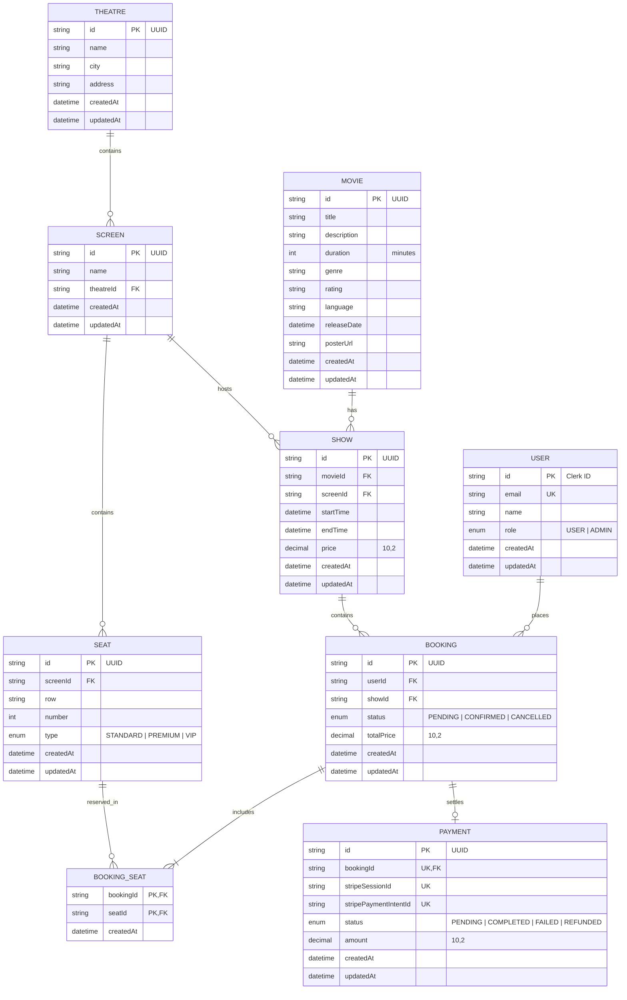
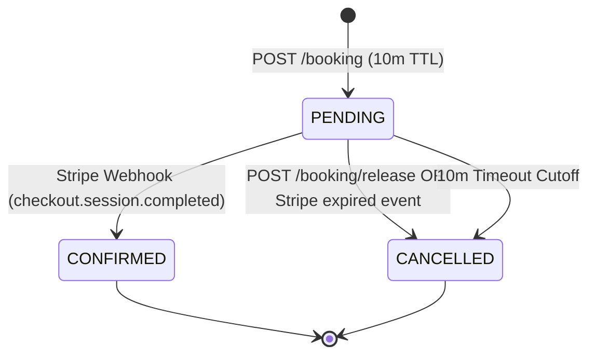
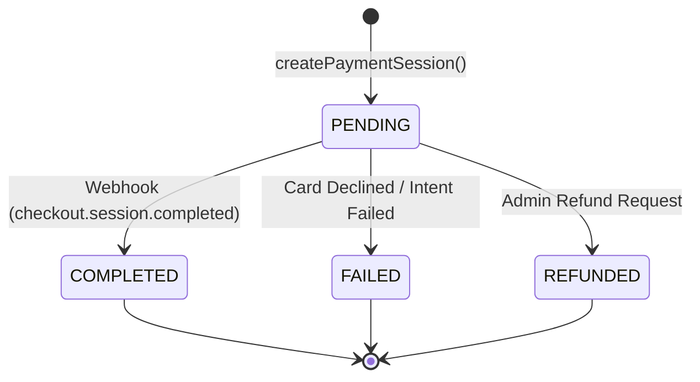

# ⚙️ ShowCity — Low-Level Design (LLD) Document

> **System**: ShowCity High-Concurrency Movie Ticket Reservation Platform  
> **Repository**: [github.com/mishraa-G/show_city](https://github.com/mishraa-G/show_city)  
> **Status**: Production-Ready Architecture  
> **Document Version**: 1.0.0  

---

## 📋 Table of Contents
1. [Software Architecture & Design Patterns](#1-software-architecture--design-patterns)
2. [Database Schema & ERD Specification](#2-database-schema--erd-specification)
   - [Entity Relationship Diagram](#entity-relationship-diagram)
   - [Table Definitions & Indexing](#table-definitions--indexing)
3. [Distributed Lock Engine Specification](#3-distributed-lock-engine-specification)
   - [Key Naming & Normalization Strategy](#key-naming--normalization-strategy)
   - [Atomic Lua Script: Multi-Seat Lock Acquisition](#atomic-lua-script-multi-seat-lock-acquisition)
   - [Atomic Lua Script: Conditional Lock Release](#atomic-lua-script-conditional-lock-release)
   - [In-Memory Mutex Fallback Engine](#in-memory-mutex-fallback-engine)
4. [API Interface Specifications](#4-api-interface-specifications)
5. [State Machine & Finite State Machine (FSM) Engine](#5-state-machine--finite-state-machine-fsm-engine)
   - [Seat State Lifecycle](#seat-state-lifecycle)
   - [Booking State Lifecycle](#booking-state-lifecycle)
   - [Payment State Lifecycle](#payment-state-lifecycle)
6. [Detailed Request Sequences & Algorithm Walkthroughs](#6-detailed-request-sequences--algorithm-walkthroughs)
   - [Algorithm: Atomic Hold with Two-Tier Verification](#algorithm-atomic-hold-with-two-tier-verification)
   - [Algorithm: Webhook Settle & Release](#algorithm-webhook-settle--release)
7. [Asynchronous Background Job Workflows (Inngest)](#7-asynchronous-background-job-workflows-inngest)
8. [Client-Side Real-Time Architecture](#8-client-side-real-time-architecture)
   - [State Management & Polling Hook](#state-management--polling-hook)
   - [Hold Timer Synchronization](#hold-timer-synchronization)
   - [Walk-out Detection (Beacon API)](#walk-out-detection-beacon-api)

---

## 1. Software Architecture & Design Patterns

The backend follows the **Layered Controller-Service-Repository Pattern** ensuring separation of concerns, testability, and deterministic failure recovery.

```
┌─────────────────────────────────────────────────────────────┐
│                      Client Request                         │
└──────────────────────────────┬──────────────────────────────┘
                               │
                               ▼
┌─────────────────────────────────────────────────────────────┐
│                      Express Router                         │
│  routes/booking.js | routes/movie.js | routes/payment.js    │
└──────────────────────────────┬──────────────────────────────┘
                               │
                               ▼
┌─────────────────────────────────────────────────────────────┐
│                     Middleware Layer                        │
│  cors | express.raw (webhooks) | express.json | auth check  │
└──────────────────────────────┬──────────────────────────────┘
                               │
                               ▼
┌─────────────────────────────────────────────────────────────┐
│                    Controller Layer                         │
│  controllers/booking.js | movie.js | payment.js             │
└──────────────┬──────────────────────────────┬───────────────┘
               │                              │
               ▼                              ▼
┌──────────────────────────────┐┌─────────────────────────────┐
│   Distributed Lock Engine    ││      Prisma ORM Client      │
│   utils/locks.js (Redis/Mem) ││         config/db.js        │
└──────────────┬───────────────┘└─────────────┬───────────────┘
               │                              │
               ▼                              ▼
┌──────────────────────────────┐┌─────────────────────────────┐
│  Redis (Upstash) Instance    ││ Neon Serverless PostgreSQL  │
└──────────────────────────────┘└─────────────────────────────┘
```

### Applied Design Patterns
- **Distributed Mutex Pattern**: Employs Redis single-threaded Lua script execution to establish atomic test-and-set semantics across distributed nodes.
- **Circuit Breaker / Fallback Pattern**: Gracefully falls back from remote Redis cluster to local Node.js event-loop in-memory lock map if Redis network round-trip fails.
- **Compensating Transaction Pattern (Saga-Lite)**: If the PostgreSQL database insertion fails after acquiring Redis locks, an immediate compensating `DEL` transaction evicts the locks to prevent deadlocks.
- **Idempotent Receiver Pattern**: Payment webhook handlers verify prior execution state to prevent duplicate ticket allocations upon network retries.

---

## 2. Database Schema & ERD Specification

### Entity Relationship Diagram



### Table Definitions & Indexing

#### 1. `Seat` Table
- **Primary Key**: `id` (`UUID`)
- **Foreign Key**: `screenId` $\to$ `Screen.id` (`ON DELETE CASCADE`)
- **Constraints**:
  - `@@unique([screenId, row, number])`: Guarantees physical uniqueness within a cinema hall.

#### 2. `Show` Table
- **Primary Key**: `id` (`UUID`)
- **Foreign Keys**:
  - `movieId` $\to$ `Movie.id`
  - `screenId` $\to$ `Screen.id`
- **Indices**:
  - `@@index([movieId])`: High-frequency queries by movie.
  - `@@index([screenId])`: Screen scheduling conflict verification.
  - `@@index([startTime])`: Filtering active vs past showtimes.

#### 3. `Booking` Table
- **Primary Key**: `id` (`UUID`)
- **Foreign Keys**:
  - `userId` $\to$ `User.id`
  - `showId` $\to$ `Show.id`
- **Indices**:
  - `@@index([userId])`: Fast history retrieval on user profile.
  - `@@index([showId])`: Fast filtering of all reservations for a screening.

#### 4. `BookingSeat` Table (Historical Line Items)
- **Primary Key**: Composite `@@id([bookingId, seatId])`
- **Foreign Keys**:
  - `bookingId` $\to$ `Booking.id` (`ON DELETE CASCADE`)
  - `seatId` $\to$ `Seat.id` (`ON DELETE CASCADE`)

#### 5. `ShowSeat` Table (Authoritative Real-Time Inventory & DB Invariant)
- **Primary Key**: Composite `@@id([showId, seatId])` (Enforces that a physical seat has exactly 1 inventory state per screening)
- **Columns**:
  - `showId`: `String` (FK $\to$ `Show.id`)
  - `seatId`: `String` (FK $\to$ `Seat.id`)
  - `bookingId`: `String?` (FK $\to$ `Booking.id`, nullable)
  - `status`: `SeatStatus` (`AVAILABLE`, `HELD`, `BOOKED`)
  - `lockedUntil`: `DateTime?` (Hold expiry cutoff)
  - `version`: `Int` (Optimistic concurrency version)
- **Indices**:
  - `@@id([showId, seatId])`
  - `@@index([showId, status])`: Sub-millisecond layout lookups
  - `@@index([bookingId])`: Fast payment/release reconciliation
  - `@@index([status, lockedUntil])`: Fast background cleanup of expired holds

#### 6. `Payment` Table
- **Primary Key**: `id` (`UUID`)
- **Foreign Key**: `bookingId` $\to$ `Booking.id` (`ON DELETE CASCADE`)
- **Unique Constraints**:
  - `@@unique([bookingId])`: Enforces 1:1 relationship between booking and payment intent.
  - `@@unique([stripeSessionId])`: Prevents duplicate webhook event insertions.

---

## 3. Distributed Lock Engine Specification

### Key Naming & Normalization Strategy

#### Normalization Logic
Seat IDs in incoming payloads can arrive in formats such as `screen-1-A-4` or raw `A-4`. The normalization helper enforces canonical naming:
```javascript
export const normalizeSeatId = (rawSeatId) => {
  if (!rawSeatId) return ''
  const parts = String(rawSeatId).split('-')
  if (parts.length >= 2) {
    const row = parts[parts.length - 2]
    const num = parts[parts.length - 1]
    if (/^[A-Za-z]$/.test(row) && /^\d+$/.test(num)) {
      return `${row.toUpperCase()}-${num}`
    }
  }
  return String(rawSeatId).trim()
}
```

#### Lock Key Syntax
```text
lock:show:{showId}:seat:{row-number}
```
*Example*: `lock:show:show-123:seat:C-4`

---

### Atomic Lua Script: Multi-Seat Lock Acquisition

To avoid the **Time-Of-Check to Time-Of-Use (TOCTOU)** race condition where two users simultaneously observe a seat as free and both issue `SET`, lock acquisition uses an atomic Redis Lua script executed within Redis's single-threaded event loop:

```lua
local userId = ARGV[1]
local ttl = tonumber(ARGV[2])

-- Step 1: Pre-check phase (All keys must be free or already owned by this user)
for i, key in ipairs(KEYS) do
  local currentHolder = redis.call('get', key)
  if currentHolder and currentHolder ~= userId then
    -- Conflict detected: Return status 0, conflicting key, and current holder ID
    return {0, key, currentHolder}
  end
end

-- Step 2: Atomic acquisition phase (Set all keys with TTL)
for i, key in ipairs(KEYS) do
  redis.call('set', key, userId, 'EX', ttl)
end

return {1, 'OK'}
```

#### Complexity Analysis
- **Time Complexity**: $\mathcal{O}(K)$ where $K$ is the number of seats requested (typically $1 \le K \le 10$).
- **Atomicity**: Executed uninterruptedly; no other Redis client can interleave commands between Step 1 and Step 2.
- **Rollback Guarantee**: If even one seat is held by another user, zero keys are set, eliminating orphan locks.

---

### Atomic Lua Script: Conditional Lock Release

When releasing locks, a user must **only delete keys they actually own** (preventing User B from evicting User A's hold):

```lua
local userId = ARGV[1]

for i, key in ipairs(KEYS) do
  local val = redis.call('get', key)
  if val == userId then
    redis.call('del', key)
  end
end

return 1
```

---

### In-Memory Mutex Fallback Engine

In case of Redis unavailability, the application switches to an internal in-memory mutex engine:
- **Storage**: `const inMemoryLocks = new Map()` mapping `key` $\to$ `{ userId: string, expiresAt: number }`
- **Reaper Daemon**: Runs every $3,000\text{ ms}$ to evict expired keys:
  ```javascript
  setInterval(() => {
    const now = Date.now()
    for (const [key, lock] of inMemoryLocks.entries()) {
      if (now > lock.expiresAt) {
        inMemoryLocks.delete(key)
      }
    }
  }, 3000)
  ```

---

## 4. API Interface Specifications

### 1. `GET /movies`
- **Description**: Returns all currently playing movies with genre, rating, and runtime.
- **Response `200 OK`**:
  ```json
  [
    {
      "id": "movie-1",
      "title": "Gladiator II",
      "description": "Years after witnessing the death of Maximus...",
      "duration": 148,
      "genre": "Action / Drama",
      "rating": "8.4",
      "language": "English",
      "releaseDate": "2024-11-22T00:00:00.000Z",
      "posterUrl": "https://images.unsplash.com/..."
    }
  ]
  ```

---

### 2. `GET /movie/:id`
- **Description**: Fetches movie details and associated showtimes with theatre metadata.
- **Response `200 OK`**:
  ```json
  {
    "id": "movie-1",
    "title": "Gladiator II",
    "shows": [
      {
        "id": "show-1",
        "startTime": "2026-08-31T20:30:00.000Z",
        "price": 15.00,
        "screen": {
          "id": "screen-1",
          "name": "Screen 1 - IMAX Laser",
          "theatre": {
            "name": "PVR ICON: Gold Class",
            "city": "San Francisco",
            "address": "845 Market St"
          }
        }
      }
    ]
  }
  ```

---

### 3. `GET /booking/locks/:showId`
- **Description**: Returns real-time state of seats: locked holds (with TTL) and confirmed bookings.
- **Headers**: `x-demo-user` (optional, for session differentiation).
- **Response `200 OK`**:
  ```json
  {
    "showId": "show-1",
    "lockedSeats": [
      {
        "seatId": "A-1",
        "ttl": 482,
        "isHeldBySelf": true
      },
      {
        "seatId": "B-4",
        "ttl": 310,
        "isHeldBySelf": false
      }
    ],
    "confirmedBookings": [
      {
        "bookingId": "bk_101",
        "seats": ["C-1", "C-2"]
      }
    ]
  }
  ```

---

### 4. `POST /booking`
- **Description**: Atomically acquires a 10-minute hold on requested seats and creates a `PENDING` booking.
- **Request Body**:
  ```json
  {
    "showId": "show-1",
    "seats": ["A-1", "A-2"]
  }
  ```
- **Response `201 Created`**:
  ```json
  {
    "message": "Seats reserved successfully for 10 minutes.",
    "booking": {
      "id": "b3e9b1d2-...",
      "userId": "user_2test",
      "showId": "show-1",
      "status": "PENDING",
      "totalPrice": 30.00,
      "createdAt": "2026-08-31T00:30:00.000Z"
    },
    "heldSeats": ["A-1", "A-2"],
    "expiresInSeconds": 600
  }
  ```
- **Error Response `409 Conflict`**:
  ```json
  {
    "error": "Seat(s) [A-1] are currently held by another customer. Please select different seats.",
    "conflictingSeats": ["A-1"]
  }
  ```

---

### 5. `POST /booking/release`
- **Description**: Releases held seats when the customer cancels checkout or navigates away.
- **Request Body**:
  ```json
  {
    "bookingId": "b3e9b1d2-...",
    "showId": "show-1",
    "seats": ["A-1", "A-2"]
  }
  ```
- **Response `200 OK`**:
  ```json
  {
    "success": true,
    "message": "Held seats have been released successfully"
  }
  ```

---

### 6. `POST /payment/session`
- **Description**: Creates a Stripe Checkout Session for a `PENDING` booking.
- **Request Body**:
  ```json
  {
    "bookingId": "b3e9b1d2-..."
  }
  ```
- **Response `200 OK`**:
  ```json
  {
    "message": "Stripe Checkout Session created",
    "sessionId": "cs_test_a1b2c3d4...",
    "url": "https://checkout.stripe.com/c/pay/cs_test_..."
  }
  ```

---

### 7. `POST /webhook`
- **Description**: Listens for Stripe events (`checkout.session.completed`, `checkout.session.expired`).
- **Headers**: `stripe-signature`
- **Raw Body**: Cryptographic Buffer
- **Response `200 OK`**:
  ```json
  {
    "received": true,
    "status": "success",
    "bookingId": "b3e9b1d2-...",
    "message": "Booking status updated to CONFIRMED and seats unlocked"
  }
  ```

---

## 5. State Machine & Finite State Machine (FSM) Engine

### Seat State Lifecycle

```
               ┌──────────────────────────────┐
               │          AVAILABLE           │
               └──────────────┬───────────────┘
                              │
               acquireSeatsLock(showId, seats)
                              │
                              ▼
               ┌──────────────────────────────┐
               │             HELD             │
               │   (Redis Lock: TTL = 600s)   │
               └───────┬──────────────┬───────┘
                       │              │
        Stripe Webhook │              │ 1. TTL expires (600s)
 (checkout.session.    │              │ 2. Tab closed (Beacon)
  completed)           │              │ 3. Explicit Cancel
                       │              │
                       ▼              ▼
       ┌─────────────────────┐ ┌─────────────────────┐
       │       BOOKED        │ │      AVAILABLE      │
       │ (PostgreSQL record  │ │  (Redis Lock DEL /  │
       │  status: CONFIRMED) │ │   Key Evicted)      │
       └─────────────────────┘ └─────────────────────┘
```

### Booking State Lifecycle



### Payment State Lifecycle



---

## 6. Detailed Request Sequences & Algorithm Walkthroughs

### Algorithm: Atomic Hold with Two-Tier Verification

```
Algorithm: createBooking(showId, seats, userId)
Input: showId, seats array, authenticated userId
Output: HTTP 201 with Booking OR HTTP 409 Conflict

1.  cleanSeats <- Map seats through normalizeSeatId(seat)
2.  lockResult <- acquireSeatsLock(showId, cleanSeats, userId, 600)
3.  IF lockResult.success == false THEN
4.      RETURN 409 Conflict { conflictingSeats: lockResult.conflictingSeats }
5.  END IF

6.  TRY:
7.      BEGIN PostgreSQL Transaction (timeout: 15s)
8.          now <- CurrentTime()
9.          lockExpiry <- now + 10 minutes
10.
11.         Upsert User record (userId)
12.         booking <- Create Booking(userId, showId, status: 'PENDING', totalPrice)
13.         Create BookingSeat records for cleanSeats (immutable line items)
14.
15.         -- ATOMIC DATABASE INVARIANT CLAIM
16.         claimResult <- UPDATE ShowSeat 
17.                        SET status = 'HELD', bookingId = booking.id, lockedUntil = lockExpiry, version = version + 1
18.                        WHERE showId = showId 
19.                          AND seatId IN (cleanSeats) 
20.                          AND (status = 'AVAILABLE' OR (status = 'HELD' AND lockedUntil < now))
21.
22.         IF claimResult.count != cleanSeats.length THEN
23.             ROLLBACK
24.             THROW Error("One or more selected seats were already booked or held")
25.         END IF
26.
27.         COMMIT Transaction
28.         RETURN 201 Created { booking, expiresInSeconds: 600 }
25.     CATCH dbError:
26.         -- Compensating Transaction
27.         releaseSeats(showId, cleanSeats, userId)
28.         IF dbError is conflict THEN
29.             RETURN 409 Conflict
30.         ELSE
31.             RETURN Local Sandbox Mock Booking (Graceful Degradation)
32.         END IF
33. END TRY
```

---

### Algorithm: Webhook Settle & Release

```
Algorithm: handleWebhook(request)
Input: Raw Buffer body, stripe-signature header

1.  IF STRIPE_WEBHOOK_SECRET is configured THEN
2.      event <- stripe.webhooks.constructEvent(body, signature, secret)
3.  ELSE
4.      event <- Parse JSON from body (Mock/Sandbox Mode)
5.  END IF

6.  IF event.type == 'checkout.session.completed' THEN
7.      bookingId <- event.data.object.metadata.bookingId
8.      sessionId <- event.data.object.id
9.      
10.     dbBooking <- Query Booking WHERE id == bookingId
11.     IF dbBooking.status == 'CONFIRMED' THEN
12.         -- Idempotent bypass
13.         RETURN 200 OK { received: true, status: 'already_confirmed' }
14.     END IF
15.
16.     BEGIN PostgreSQL Transaction
17.         Update Booking SET status = 'CONFIRMED' WHERE id == bookingId
18.         Upsert Payment SET status = 'COMPLETED', stripeSessionId = sessionId
19.     COMMIT Transaction
20.
21.     -- Release temporary Redis hold
22.     releaseSeats(dbBooking.showId, dbBooking.seats)
23.
24.     -- Dispatch async job
25.     inngest.send('booking.confirmed', { bookingId, showId, seats })
26.     RETURN 200 OK { received: true }
27. END IF
```

---

## 7. Asynchronous Background Job Workflows (Inngest)

```
             POST /webhook (checkout.session.completed)
                                │
                                ▼
               inngest.send("booking.confirmed")
                                │
          ┌─────────────────────┴─────────────────────┐
          ▼                                           ▼
┌──────────────────────────────┐        ┌──────────────────────────────┐
│  sendTicketConfirmationEmail │        │      scheduleShowReminder    │
│                              │        │                              │
│ 1. step.run: fetch booking   │        │ 1. step.run: log reminder    │
│ 2. step.run: send email      │        │    (scheduled 2h before show)│
└──────────────────────────────┘        └──────────────────────────────┘
```

- **Execution Model**: Inngest functions use step-based durable execution. If the mail transport server experiences transient downtime, Inngest automatically retries with exponential backoff without repeating already completed database queries.
- **Events**:
  - `booking.confirmed`: Triggered upon successful Stripe payment settlement.
  - Payloads contain: `{ bookingId, showId, seats }`.

---

## 8. Client-Side Real-Time Architecture

### State Management & Polling Hook
The `SeatSelection.tsx` component orchestrates real-time inventory updates:

```typescript
// Background Polling Engine
useEffect(() => {
  if (!showId) return

  const fetchLocks = async () => {
    try {
      const data = await getShowLocks(showId, demoUser)
      setLockedSeats(data.lockedSeats || [])
      setBookedSeats(data.confirmedBookings || [])
    } catch (err) {
      console.warn('Poll error:', err)
    }
  }

  fetchLocks() // Initial immediate fetch
  const interval = setInterval(fetchLocks, 3000) // Sub-3s synchronization cadence

  return () => clearInterval(interval)
}, [showId, demoUser])
```

### Hold Timer Synchronization
- When a hold is acquired, `expiresInSeconds: 600` is received from the server.
- The client stores `{ bookingId, showId, seats, expiresAt: Date.now() + 600000 }` in `sessionStorage`.
- A 1-second ticker calculates `remainingSec = Math.max(0, Math.floor((expiresAt - Date.now()) / 1000))` and displays a live `MM:SS` countdown badge.
- When `remainingSec === 0`, the client automatically clears the hold, alerts the user, and reloads the seat layout.

### Walk-out Detection (Beacon API)
If a user closes their browser window or tab while holding seats:
```typescript
useEffect(() => {
  const handleUnload = () => {
    const hold = getActiveHold()
    if (hold) {
      const payload = JSON.stringify({
        bookingId: hold.bookingId,
        showId: hold.showId,
        seats: hold.seats
      })
      navigator.sendBeacon(`${API_BASE}/booking/release`, payload)
    }
  }

  window.addEventListener('beforeunload', handleUnload)
  return () => window.removeEventListener('beforeunload', handleUnload)
}, [])
```
This guarantees seats are released immediately without waiting for the 10-minute Redis TTL to expire.
